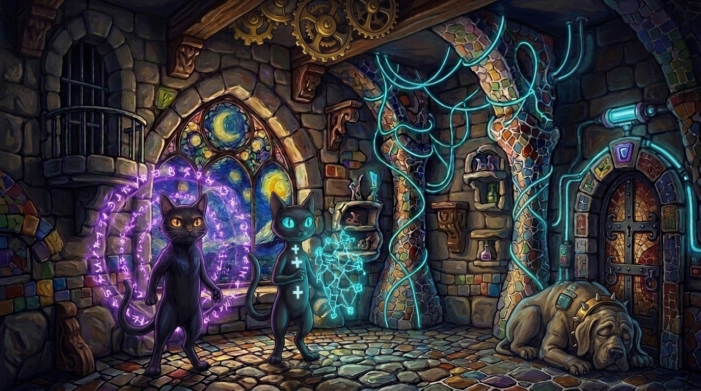
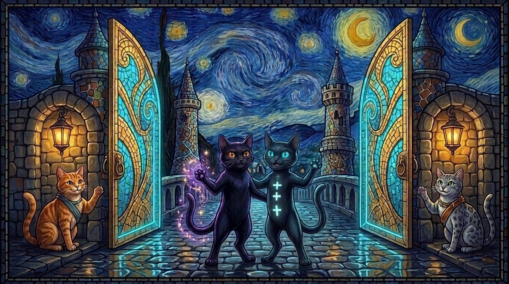

<p align="center">
  
</p>

<h1 align="center">Коты Башни: Тень и Искра · Tower Cats: Shadow & Spark · Gatos de la Torre: Sombra y Chispa</h1>

<p align="center">
  <em>An interactive 10-chapter Gobliins-inspired 2D point-and-click puzzle adventure painted in a fusion of Van Gogh’s Starry Night, Gaudí’s mosaic architecture, and neon cyberpunk.</em>
</p>

<p align="center">
  <strong>Languages:</strong> 🇷🇺 Русский · 🇬🇧 English · 🇪🇸 Español &nbsp;|&nbsp;
  <strong>Audio:</strong> 20-Minute Seamless Procedural Loop + Multi-Language AI Voice Acting
</p>

---

## Story & Heroes

Locked inside the topmost attic cell of a spiraling mosaic-and-neon tower, two black cats must team up to descend ten intricate chambers and outsmart the colossal snoring cyber-watchdog **Baskerville** at the gates:

- **Thomas (Томас / Tomás)** — *The Solid-Black Mage Cat*
  - Sleek, pure-black fur and golden-amber eyes.
  - Casts long-range arcane spells from anywhere in sight (unless blocked by lead bars):
    - **Telekinesis (`Q`)** — lifts, flings, and turns distant mechanisms, switches, and keys.
    - **Enlarge (`W`)** — swells small pillows, gears, bones, or resonator bells to giant scale.
    - **Shrink (`E`)** — shrinks massive counterweights, heavy bolts, drone guards, or rowdy pests.
    - **Shadow Hop (`R`)** — teleports instantly between dark shadow portals across lead bars and chasms.
- **Torquemada (Торквемада)** — *The Hacker Cat*
  - Sleek black fur with glowing cyan eyes and **three vertical white cross markings** from neck to belly.
  - Walks the 2D floors and interacts physically with machines and inventory items:
    - **Paws (`Q`)** — picks up keys, fuses, gears, and keycards, presses buttons, and inserts items.
    - **Hacker Spark (`W`)** — embraces 220V static to crack security panels, overload lasers, fry pest static, and power electric generators.
- **Friendly Helpers & Troublesome Pests**
  - Along the tower you will meet colorful feline locals of every coat — **ginger Archimedes**, **white soprano**, and **ginger-white archivist Murzik** lending clues, alongside cheeky **tabby**, **gray**, and **snow-white pest cats** blocking machinery. Only Thomas and Torquemada wear pure black!

---

## Features

- **10 Hand-Crafted Tower Chambers** — from the topmost attic prison and alchemist’s acid moat to Van Gogh’s Starry Observatory, Gaudí’s Organ Hall, Clockwork Gear Tower, Neon Sunflower Conservatory, Hologram Archive, Cyber-Gargoyle Forge, Magnetic Helix Abyss, and Baskerville’s Final Gate Rematch.
- **Gobliins-Style Dual-Character Puzzle Design** — combine spatial teleportation, object scaling, parabolic telekinetic item throws, electrical hacking, and dual-cat synchronized timing (like holding left & right organ pedals simultaneously).
- **Rich Raster Artwork & Live Scene Animations** — bespoke painted room backdrops, multi-frame cat sprites, grounded shadows, parabolic flying items, laser beams, glowing light rays, hinged animated doors, and dynamic walk-out cutscenes.
- **Full 3-Language Localization (`RU` / `EN` / `ES`)** — instant switching between **Russian**, **English**, and **Spanish** from the Title Screen, bottom HUD dock (`Globe` icon), or Pause menu, updating all UI copy, chapter titles, hints, hotspots, inventory items, and spoken dialogue.
- **Expressive Character Voiceover** — server-side `/api/tts` integration powered by Gemini TTS (`Charon`, `Puck`, `Fenrir`, `Zephyr` personas tailored per language) with automatic browser `speechSynthesis` and retro Gobliins-style synthesizer chatter fallbacks.
- **20-Minute Closed-Loop Soundtrack** — a continuous **1200-second (600 bars @ 120 BPM)** procedural 10-movement Web Audio score with stereo cathedral delay reverb and automatic ducking whenever characters speak.

---

## Controls

| Input | Action |
| :--- | :--- |
| **Left Click (Floor / Object)** | Walk on the 2D floor or interact with an object / NPC / exit |
| **Click Inactive Cat** or **`1` / `2`** or **`Tab`** | Switch active cat (`1` = Thomas, `2` = Torquemada) |
| **`Q` / `W` / `E` / `R`** | Select active cat spell or skill (`Q`/`W` for Torquemada) |
| **`H`** | Cycle hint tiers (Nudge → Full Step-by-Step Plan → Hide) |
| **`Esc`** | Pause menu (with instant `RU / EN / ES` switcher) |
| **Bottom Dock** | Icon-only bar for cat selection, spells/skills, backpack items, hints, restart, 20-min music toggle, sound mute, language cycle, and pause |

---

## Tower Chapters Overview

1. **Attic Tower Cell** *(Камера под крышей / Celda bajo el Tejado)* — Silent key drop & cyber-lullaby for Baskerville.
2. **Alchemist’s Cyber-Lab** *(Мастерская Алхимика / Taller del Alquimista)* — Pneumatic fuse heist & plank drawbridge over neon acid.
3. **Starry Night Observatory** *(Обсерватория Звёздной Ночи / Observatorio de la Noche Estrellada)* — Shooing Tabby Rascal and aligning a golden Van Gogh starbeam.
4. **Gaudí’s Organ Hall** *(Органный Зал Гауди / Sala del Órgano de Gaudí)* — Pipe repair and a simultaneous two-cat acoustic chord.
5. **Clockwork Gear Tower** *(Часовая Шестерёночная / Torre de los Engranajes)* — Resizing cogs across the pendulum chasm and shrinking the jam weight.
6. **Neon Sunflower Conservatory** *(Теплица Неоновых Подсолнухов / Invernadero de Girasoles Neón)* — Blinding the carnivorous bloom, lulling it to sleep, and evicting Gray Grabby.
7. **Archive of Holograms & Scrolls** *(Архив Голограмм и Свитков / Archivo de Hologramas y Pergaminos)* — Magnifying micro-runes (`7-4-2`) and disabling the laser grid.
8. **Cyber-Gargoyle Forge** *(Кузница Кибер-Горгульи / Forja de la Ciber-Gárgola)* — Superheating bellows, melting solder, and shrinking the iron gate bolt.
9. **Spiral Helix Well** *(Винтовая Лестница Спиралей / Pozo de la Escalera Espiral)* — Shrinking the Patrol Pug-Drone and dropping the ceiling mag-bridge.
10. **Gates of Freedom** *(Врата Свободы / Puertas de la Libertad)* — Launching a colossal rubber Mega-Bone by catapult and spinning the ancient gate wheel.

---

## Project Structure

```text
├── server.ts                  # Express + Vite dev middleware + /api/tts Gemini TTS proxy (RU/EN/ES)
├── src/
│   ├── App.tsx                # 60fps simulation loop, pathing, cutscenes, state & HUD orchestration
│   ├── components/
│   │   ├── TitleScreen.tsx    # Animated hero title screen, chapter drawer & language switcher
│   │   ├── GameHud.tsx        # Top floating speech/hint window & bottom icon-only utility dock
│   │   └── GameModals.tsx     # Caught, Level Win, Game Victory & Pause modals
│   ├── game/
│   │   ├── i18n.ts            # Trilingual UI dictionary (RU/EN/ES) & translation helpers
│   │   ├── levels_loc.ts      # Complete EN & ES translations for all 292 level strings
│   │   ├── levels.ts          # 10 chapters, hotspots, walkZones, zoneLinks & interaction logic
│   │   ├── renderer.ts        # Full-canvas scene & character animation renderer
│   │   ├── sprites.ts         # Raster backdrop & sprite-sheet loader/cache
│   │   ├── audio.ts           # Procedural SFX engine
│   │   ├── music.ts           # 20-minute (1200s) seamless 10-movement Web Audio soundtrack
│   │   ├── voice.ts           # Multilingual TTS client with browser & chatter fallback
│   │   └── types.ts           # Core TypeScript game interfaces
│   └── assets/images/         # Painted tower rooms, cat sprite sheets, props & README banners
└── .env.example               # GEMINI_API_KEY configuration template
```

---

## Local Setup & Running

### 1. Install Dependencies

```bash
npm install
```

### 2. Configure Environment (Optional for AI Voiceover)

Copy `.env.example` to `.env` and set your Gemini API key if you want neural AI character voices via `/api/tts` (the game works out of the box even without a key using browser speech / Gobliins chatter fallbacks):

```bash
cp .env.example .env
# Edit .env and set GEMINI_API_KEY="your_key_here"
```

### 3. Run in Development

```bash
npm run dev
```

Open `http://localhost:3000` in your browser.

### 4. Production Build & Start

```bash
npm run lint
npm run build
npm start
```

---

<p align="center">
  
</p>
